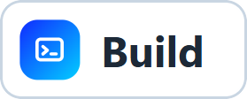

<p align="center"></p>

<h1 align="center">Remotune</h1>

<p align="center"><b>Remotune automatically tunes Windows for remote desktop sessions and restores your original state when the session ends.</b></p>

<p align="center"><a href="#why-remotune"><picture><source media="(prefers-color-scheme: dark)" srcset="assets/readme/nav-why-dark.webp"></picture></a> <a href="#how-it-works"><picture><source media="(prefers-color-scheme: dark)" srcset="assets/readme/nav-how-dark.webp"></picture></a> <a href="#using-remotune"><picture><source media="(prefers-color-scheme: dark)" srcset="assets/readme/nav-using-dark.webp"></picture></a> <a href="#safety-model"><picture><source media="(prefers-color-scheme: dark)" srcset="assets/readme/nav-safety-dark.webp"></picture></a> <a href="#requirements-and-install"><picture><source media="(prefers-color-scheme: dark)" srcset="assets/readme/nav-requirements-dark.webp"></picture></a> <a href="#build-from-source"><picture><source media="(prefers-color-scheme: dark)" srcset="assets/readme/nav-build-dark.webp"></picture></a> <a href="#status-and-limits"><picture><source media="(prefers-color-scheme: dark)" srcset="assets/readme/nav-status-dark.webp"></picture></a></p>

## Why Remotune

A Windows desktop tuned for sitting in front of it is not always the best one to stream. Over Chrome Remote Desktop (CRD) every window animation, fade and slide is more screen change to capture, encode and send, so a slow link feels laggier.

The taskbar can also get in the way. When both the local and the remote taskbar auto-hide at the bottom edge, moving the pointer there can reveal both, and the local taskbar can cover the remote one.

Remotune runs on the controlled machine, the PC that hosts CRD. While CRD is connected it applies the Windows Visual Effects profile you chose and turns taskbar auto-hide off. When CRD disconnects it puts Windows back.

Remotune does not touch CRD's codec or transport, and it is not a general Windows tweaker. The only settings it changes are the Visual Effects from Windows Performance Options and taskbar auto-hide. Applications that draw their own animations are not affected.

## How it works

<picture><source media="(prefers-color-scheme: dark)" srcset="assets/readme/workflow-dark.webp"></picture>

Remotune reads the connect and disconnect events that the CRD host writes to the Windows Event Log. Process presence is not used as a signal, and when Remotune starts during a session it rebuilds the current state from the log history.

| When | Choices | Effect |
|---|---|---|
| CRD ON | Let Windows choose, Best Appearance, Best Performance, Custom | Applied while CRD is connected. Custom is your own selection of the 17 Visual Effects checkboxes from Windows Performance Options. |
| CRD OFF | Revert to snapshot | Restores the exact Visual Effects state saved before CRD connected. |
| CRD OFF | Let Windows choose, Best Appearance, Best Performance | Applies that profile instead, deliberately replacing the saved state. |

Taskbar auto-hide always returns to the exact state it had before CRD connected. Let Windows choose sets the Windows label without rewriting individual effects, because Windows was observed not to recompute them when the label changes.

## Using Remotune

<picture><source media="(prefers-color-scheme: dark)" srcset="assets/readme/popup-dark.webp"></picture>

- Open the window from the tray icon or the tray menu's Open command. The X hides it; Remotune keeps running in the tray.
- The tray menu has a status line, Pause Automation or Resume Automation, Restore Now, Start with Windows, Open and Quit.
- Pause restores anything Remotune changed, then stops reacting to CRD until you resume.
- Restore Now acts only on a Remotune-owned snapshot and does nothing without one.
- Quit from the tray restores first. If the restore fails, quitting is blocked and the tray status says so.
- Start with Windows registers the current executable path. If you move the executable, the popup warns that the startup entry points to a moved executable.

## Safety model

<picture><source media="(prefers-color-scheme: dark)" srcset="assets/readme/states-dark.webp"></picture>

- The snapshot is written to disk before anything changes, and a repeated connect never replaces the original baseline with the already-tuned state.
- No Remotune-owned snapshot means no guessed restore. Windows being in Best Performance does not prove Remotune put it there.
- The snapshot is retired only after Windows is read back and matches. A partial apply or restore is reported as Partial/Error and the snapshot is kept.
- After a crash or restart, Remotune reconstructs the CRD state and reconciles it with the saved snapshot, so Windows is not left in a temporary override.
- CRD events carry the account email and client address. Remotune drops them when it parses an event and never stores them.
- The snapshot lives at `%LOCALAPPDATA%\Remotune\recovery.json`.

## Requirements and install

- Windows 11. The evidence so far comes from Windows 11 Pro 23H2 (build 22631); Windows 10 has not been verified.
- Chrome Remote Desktop host on the same machine.
- Microsoft Edge WebView2 Runtime. Remotune checks for it at startup and reports it clearly when it is missing.
- A normal user account. No administrator rights are needed for anything exercised so far.

There is no installer. Build the portable executable as described below and run it from any folder.

## Build from source

You need Go 1.26.1, Bun, and the Wails CLI at exactly `v3.0.0-beta.8` (see the [Wails v3 installation guide](https://v3.wails.io/quick-start/installation/)). The Go module, the CLI and the frontend runtime are pinned to that same release, and the frontend installs from its lockfile.

```powershell
wails3 dev
wails3 task verify
wails3 task windows:portable
```

- `wails3 dev` runs Wails dev mode: Vite hot-reloads the frontend and Wails rebuilds and relaunches the app when Go code changes.
- `wails3 task verify` generates bindings, builds the frontend, then checks formatting, runs `go vet` and the short Go tests.
- `wails3 task windows:portable` writes `out\remotune-v<version>.exe`. The version comes from `build/config.yml`, and the build stops if the destination executable is locked because it is still running.

## Status and limits

Verified on one real machine (Windows 11 Pro 23H2, CRD host 152.0.7977.9, one display, non-elevated user):

- CRD connect and disconnect detection, including starting while connected and a live subscription.
- Exact round-trip of an arbitrary Custom Visual Effects state, and taskbar auto-hide round-trip from both ON and OFF.
- Apply, then Pause with restore, then Resume with reapply, then Quit with restore.
- Start with Windows launching after sign-in.

Not verified yet:

- Windows 10, multiple monitors and secondary taskbars, and an Explorer restart while Remotune owns an override.
- More than one simultaneous CRD client. Remotune tracks clients as a set, so either behavior is handled.
- The frameless popup of the latest build on a real machine.
- Long-running sessions, crash and restart recovery under a live CRD session, and the missing-WebView2 path.

Out of scope: replacing CRD, optimizing a network or codec, general Windows tweaking, the Advanced and Data Execution Prevention tabs of Performance Options, and providers other than CRD.

<details>
<summary>Repository layout</summary>

| Path | Contents |
|---|---|
| `main.go`, `tray.go` | Wails bootstrap and the tray menu |
| `internal/wintune` | Visual Effects and taskbar adapters |
| `internal/crd` | CRD detector over the Windows Event Log |
| `internal/application` | Coordinator, recovery store and tuning state machine |
| `internal/lifecycle` | Service bridge, WebView2 check, autostart |
| `frontend/` | Vue control surface |
| `assets/` | Brand mark, tray icon, README illustrations and their sources |
| `build/` | Wails configuration and Windows resources |
| `cmd/` | Operator tools |
| `tools/phase0/` | Evidence scripts from the Windows and CRD research spike |
| `docs/baseline/` | Design, decisions and evidence |
| `docs/runbook/` | Runbooks |
| `engine/` | Superseded standalone module kept for reference |

</details>


